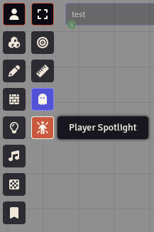
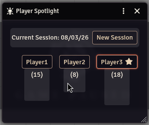

# fvtt-player-spotlight

A foundryVTT module that helps GMs track who is getting the spotlight during sessions and campaigns.

## Installation

You can install [this module on Foundry VTT](https://foundryvtt.com/packages/fvtt-player-spotlight) by searching for it.

Alternatively, you can use the url `https://github.com/HectorCastelli/fvtt-player-spotlight/releases/latest/download/module.json` to install the latest module version on your Foundry instance.

## Features

> Note: Not all features listed here are available.
>
> Features that are planned but not yet implemented are noted by a `🔜` symbol

### Keep an eye on the spotlight

Click the spotlight icon on the right of the player list, to display the `Player Spotlight` window.



Once open, you will have access to an up-to-date view on how the spotlight is being shared across your players:



#### Tracking your game

We offer two view modes that you can toggle:

- `Session Mode`: Shows only the data for the current session.
- 🔜 `Campaign Mode`: shows all the data available. Highlighting the portion that corresponds to the current session.

<!-- TODO: show screenshot of this feature. -->

#### Choose a sorting mode

To help you determine who should receive the spotlight next, we offer two modes:

- `Queue mode`: Whenever a player receives a spotlight, it will be moved to the end of the list. This means that players at the start of the list are the ones that should be considered for a spotlight next!
- `Stable mode`: Players are sorted by their names, so clicking them will not reorder the list. In this case, you can track the overall count of spotlights, and watch the `star` icon to see who received the spotlight last.

|                   Queue mode                    |                   Stable Mode                    |
| :---------------------------------------------: | :----------------------------------------------: |
| [Queue mode in action](./assets/queue-mode.mp4) | [Stable mode in action](./assets/queue-mode.mp4) |

### Track sessions

When you start a new session, you can press the `New session` button. This will start a new, clean, tracker for the current session.

Optionally, this can be done automatically when the date changes by enabling the `Session Auto Start` setting.

### Track when you spotlight a player

You can _left-click_ a player card to indicate they received a spotlight, or _right-click_ them to remove or undo a spotlight.

Clicking a player card will always register the spotlight on the most recently created session.

### Who you see

#### See active players

If you share a world between multiple groups, the player list might be long, but you might not want to see those that are offline during a session.

To reduce visual noise and keep the interface clean, you can enable the `Player filter` setting, causing only players that are active will be visible.

#### Track Characters & Players

You can switch the tracking mode to display the Player's character names instead of their names by changing the `Use Name` settings between:

- `Player names`: Shows player names.
- `Character names`: Shows the name of the character associated with the player.
- `Mixed`: Shows the name of the character associated with the player, and the player name side by side.

## Contributing

This project is fully open source and open to external contributions.

You can contribute by reporting bugs, suggesting features, and submitting Pull Requests with improvements and fixes.

The working language is English, even if the module supports other languages during runtime.

### AI use

This project does **NOT** accept AI-generated content, nor code.

All code and content contributions must comply with the [FoundryVTT AI Content Policy](https://foundryvtt.com/article/ai-policy/) definition for "Zero AI".

AI tools may be used to report bugs or requests features, for the purpose of translation or rewriting.
In these cases, the use of AI assistance (where the majority of the work is performed by a human, and any AI-generated output is validated by a human) is allowed as long as a disclaimer is added at the time of reporting.
Submissions by AI systems without human supervision is not allowed.

### Development

This repository comes with a [setup script](./scripts/foundry-setup.js) that can install the local module version into your instance.
This is helpful to test changes as you develop new features.

If you need to download and install a Foundry Node instance for local testing, run:

```sh
npm run foundry:install
```

The script prompts for a one-time download URL. It skips downloading when
`test/local/instance` already matches the module's verified Foundry version.

Start the local instance on <http://localhost:31234> with its local data folder using:

```sh
npm run foundry:run
```

Once you have an instance ready, use the setup script with [your Foundry `Data/` folder path](https://foundryvtt.com/article/user-data/), for example:

```sh
npm run foundry:setup -- /my/foundry/Data
```

### Release process

When a new version of the module is ready to be released, we use the [release script](./scripts/release.js).

To use this script, choose a version bump type, for example:

```sh
npm run release -- patch
```

Version numbers adhere to [Semantic Versioning 2.0.0](https://semver.org/spec/v2.0.0.html). The script will find the latest version published then apply the requested `major`, `minor`, or `patch` bump.

The script will:

- Generate `dist/CHANGELOG.md` from commits since the previous release
- Generate an updated `dist/module.json` with the new version
- Build `dist/module.zip` directly from the necessary module files, without an intermediate copy
- Create an annotated Git tag and push the branch and tag to GitHub
- Create a GitHub release with the generated assets and changelog
